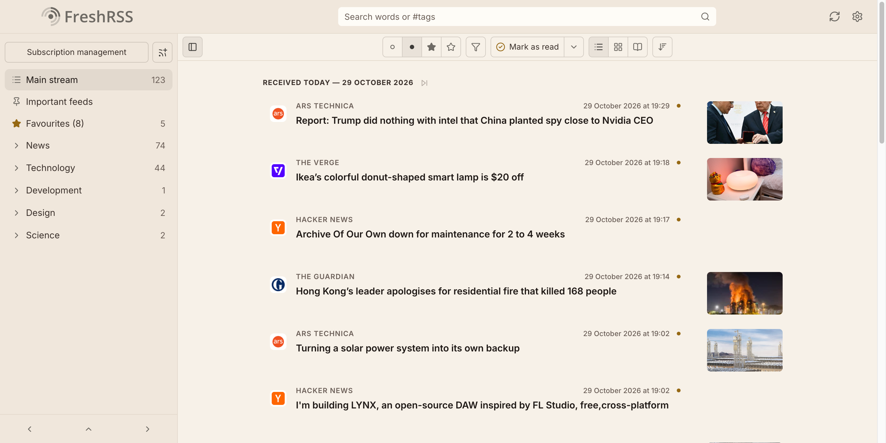
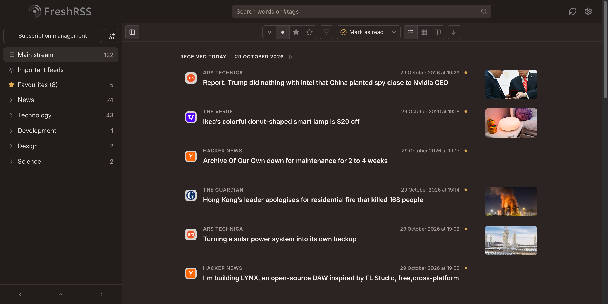

# Reed

A calm, warm theme for [FreshRSS](https://freshrss.org).

<p>
  
  
</p>

- Warm paper palette by day and warm brown by night, each with an amber accent
- Centred article column without row separators, large favicons and uppercase feed names
- Grouped settings pages with pill switches
- [Lucide](https://lucide.dev) icons throughout
- Bundled [Inter](https://rsms.me/inter/) for the interface and [Literata](https://github.com/googlefonts/literata) for articles, so text looks the same on every OS

Built and tested against FreshRSS 1.30.4.

Prefer a denser list? [Reed Compact](https://github.com/SiggeMcKvack/reed-compact-theme) shows one article per line.

## Installation

The theme's folder name is its ID in FreshRSS. These steps use `Reed`.

### Manual

Copy the repository contents into `p/themes/Reed` in your FreshRSS installation:

```sh
git clone --depth 1 https://github.com/SiggeMcKvack/reed-theme.git p/themes/Reed
rm -rf p/themes/Reed/.git
```

`p/` is publicly served, so remove `.git` rather than leaving it readable.

### Docker

Mount the theme as its own folder. Don't mount over `/app/www/p/themes`: that would hide FreshRSS's built-in themes, including `base-theme`, which Reed depends on.

```yaml
services:
  freshrss:
    image: linuxserver/freshrss:latest
    volumes:
      - ./config:/config
      - ./reed-theme:/app/www/p/themes/Reed
```

Adjust the container path for other images. For example, the official `freshrss/freshrss` image uses `/var/www/FreshRSS/p/themes/Reed`.

### Enable

Go to **Settings → Display → Theme** and choose **Reed**, then do a hard refresh (Cmd/Ctrl+Shift+R).

Reed follows the system's light or dark appearance while **Settings → Display → Automatic dark mode** is set to **Auto** (the default). Set it to **No** to always use the light palette. FreshRSS has no setting to always use the dark one.

The theme is set per user. The login page uses the theme of the internal `_` user. To theme it too, set `'theme' => 'Reed'` in `data/users/_/config.php`.

## Known limitations

- Statistics chart colours are hard-coded by FreshRSS and aren't themed.
- Icons in background-loaded panels are swapped through CSS `content: url()`, which may not work in Firefox.

## Development

`reed.rtl.css` is what FreshRSS loads for right-to-left languages. Regenerate it after editing `reed.css`:

```sh
npx rtlcss@4.3.0 reed.css reed.rtl.css
```

The fonts are split by script so browsers only download Greek and Cyrillic when an article needs them. To update a font, regenerate its files from the variable TTFs (Inter from its [releases](https://github.com/rsms/inter/releases), Literata from [google/fonts](https://github.com/google/fonts/tree/main/ofl/literata)). The script needs `fonttools` and `brotli`:

```sh
tools/subset-fonts.py InterVariable.ttf 'Literata[opsz,wght].ttf' 'Literata-Italic[opsz,wght].ttf'
```

After upgrading FreshRSS, run `tools/check-upstream.sh [container]` (default container: `freshrss`). It reports new icons without a Reed copy, base colour variables Reed doesn't set, markup the layout relies on that has disappeared, changes to upstream's mobile article-list grid, and a stale `reed.rtl.css`.

## License

[AGPL-3.0](LICENSE), same as FreshRSS. Lucide icons are [ISC licensed](LICENSE-lucide). Inter and Literata are OFL-1.1 licensed ([Inter](LICENSE-inter), [Literata](LICENSE-literata)).
